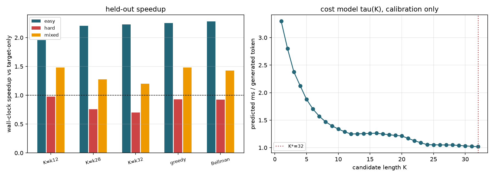

# 成本感知自适应 K（v2）

## 与 v1 的区别

v1 用 draft softmax 置信度早停，动机来自一个已被证伪的「危险率随深度衰减」结论，
且在该语料上三个阈值从未触发，speedup 全部低于固定 K=28。v2 改为由实测墙钟成本驱动：
`C(K)` 来自主库解码器逐轮实测，`hazard` 在线估计，固定 K 用 `K*=argmin C(K)/(E[A(K)]+1)` 选择。
进一步用有限时域 Bellman 方程求每轮最优 K：

`V(n) = min_K [ C(K) + E_h[V(n-A-1)] ]`，`A` 为截断几何接受数，`V(0)=0`。

逐轮贪心 `tau` 只对应无限时域，Bellman 解额外处理生成末尾的截断，
在模型假设与平稳 hazard 下是全局最优策略，固定 K 只是其策略空间的一个元素。
两个自适应变体（greedy / Bellman）均通过 `speculative_generate` 的 trace 与 k_policy 驱动，
项目内只有一份解码循环，接受率与目标调用数口径完全一致。

calibration: 6 条 prompt，hazard=0.9918，C(K) 线性拟合 R^2=0.986，选出 K*=32。

**可证结论**：固定 K 是 Bellman 策略空间的子集，故在模型准确且 hazard 平稳时，
Bellman 策略的期望耗时不高于任何固定 K。实测若出现偏差，来源只能是成本模型误差、
在线 hazard 估计误差或策略自身的额外 Python 开销，报告不掩盖这些偏差。

hazard 异质或非平稳时，在线估计才可能带来超出平稳情形的收益。

## Held-out 结果

| 组 | hazard 均值 | hazard Gini | 策略 | speedup | 95% CI | 平均选中 K | 严格等价 |
|---|---:|---:|---|---:|---|---:|---|
| easy | 0.9833 | 0.0075 | fixed_k12 | 1.959x | [1.824, 2.093] | - | n/a |
| easy | 0.9833 | 0.0075 | fixed_k28 | 2.205x | [1.963, 2.449] | - | n/a |
| easy | 0.9833 | 0.0075 | fixed_k32 | 2.226x | [1.997, 2.530] | - | n/a |
| easy | 0.9833 | 0.0075 | adaptive_greedy_tau | 2.250x | [1.999, 2.575] | 20.0 | True |
| easy | 0.9833 | 0.0075 | adaptive_bellman_dp | 2.279x | [2.020, 2.623] | 20.0 | True |
| hard | 0.8760 | 0.0336 | fixed_k12 | 0.975x | [0.809, 1.211] | - | n/a |
| hard | 0.8760 | 0.0336 | fixed_k28 | 0.760x | [0.614, 1.000] | - | n/a |
| hard | 0.8760 | 0.0336 | fixed_k32 | 0.699x | [0.553, 0.939] | - | n/a |
| hard | 0.8760 | 0.0336 | adaptive_greedy_tau | 0.929x | [0.781, 1.182] | 10.5 | True |
| hard | 0.8760 | 0.0336 | adaptive_bellman_dp | 0.927x | [0.802, 1.131] | 10.5 | True |
| mixed | 0.9339 | 0.0412 | fixed_k12 | 1.481x | [1.141, 2.067] | - | n/a |
| mixed | 0.9339 | 0.0412 | fixed_k28 | 1.276x | [0.848, 2.273] | - | n/a |
| mixed | 0.9339 | 0.0412 | fixed_k32 | 1.201x | [0.780, 2.222] | - | n/a |
| mixed | 0.9339 | 0.0412 | adaptive_greedy_tau | 1.482x | [1.070, 2.311] | 18.0 | True |
| mixed | 0.9339 | 0.0412 | adaptive_bellman_dp | 1.430x | [1.055, 2.179] | 18.0 | True |

## 实测结论

- `easy`: 最优固定策略 fixed_k32 = 2.226x，Bellman 自适应 = 2.279x，差值 +0.052x；两者 95% CI 重叠，差异不显著。
- `hard`: 最优固定策略 fixed_k12 = 0.975x，Bellman 自适应 = 0.927x，差值 -0.049x；两者 95% CI 重叠，差异不显著。
- `mixed`: 最优固定策略 fixed_k12 = 1.481x，Bellman 自适应 = 1.430x，差值 -0.051x；两者 95% CI 重叠，差异不显著。

- `hard` 组固定 K=28 出现**负加速** 0.760x，说明原项目 2.34x 高度依赖低熵语料，不能外推。
- 平稳 hazard 下固定 K 已接近最优，自适应与固定 K 的差异落在置信区间内，
  与 Bellman 最优性一致（固定 K 是策略子集，故理论上不可能严格更优）。
  可复现的收益是**在分布偏移时避免长 K 的负加速**，而非凭空提高峰值 speedup。
- 偏差来源：C(K) 由整次生成逐轮实测，仍含少量末尾截断混合；
  在线 hazard 从 calibration 先验冷启动；策略与 trace 有额外 Python 开销。

## 计时协议与边界

所有策略（含 baseline）在同一时间窗内按 repeat 轮转交错测量，
消除 CPU 频率漂移被误当成策略收益。speedup 的置信区间按 prompt 配对自助重采样。
calibration 与 held-out 完全分离。`hard` 组为随机 token 前缀，
`mixed` 组混合两种难度，用于构造 hazard 异质。

