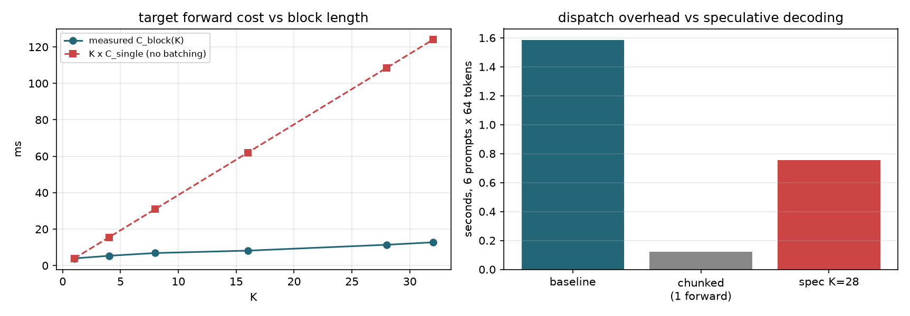

# 加速来源归因

v1 用「目标调用减少 90.10%」解释 2.34x，但一次 28-token 块验证与
一次 1-token bonus 前向都被记成 1 次调用，成本相差一个量级。
本脚本实测基本前向成本并分解收益。

- 单次 1-token target 前向: 3.875 ms
- 单次 1-token draft 前向: 0.696 ms
- 6 prompt x 64 token 的增量自回归基线: 1.584 s
- 同样 6 prompt 的整块单次前向（无解码循环）: 0.122 s
- Python/调度开销占基线比例: 92.3%

| K | C_block(K) ms | 批处理摊薄倍数 | 实测 speedup |
|---:|---:|---:|---:|
| 4 | 5.360 | 2.89x | 1.311x |
| 8 | 6.865 | 4.52x | 1.680x |
| 12 | 12.742 | 3.65x | 1.982x |
| 20 | 12.742 | 6.08x | 2.033x |
| 28 | 11.407 | 9.51x | 2.093x |
| 32 | 12.742 | 9.73x | 2.234x |

## 结论

基线的相当一部分时间来自逐 token 的调度开销，因此减少调用次数是主要收益来源。
批处理摊薄倍数在 K=28 处约 9.51x，
这是 CPU 上微型 Transformer 的特性，不能直接外推到 GPU 大模型服务。

## torch.compile 对照

本机不可用: InductorError: RuntimeError: Compiler: cl is not found.

Set TORCHDYNAMO_VERBOSE=1 for the internal stack trace (please do this especially if you're reporting a bug to PyTorch). For even more developer context, set TORCH_LOGS="+dynamo"

该对照需要在带 CPU C++ 编译器的环境重跑。

