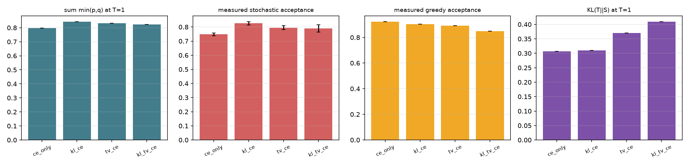

# 蒸馏目标消融：TV 与 KL 谁更贴近接受率

## 修正 v1 的范畴错误

随机模式下 `E[accept] = sum min(p,q) = 1 - TV(p,q)`，
Pinsker 不等式给出 `E[accept] >= 1 - sqrt(KL/2)`。
贪婪模式下接受事件是 `argmax(q) == argmax(p)`，由 top-1 一致率决定。
v1 把 `sum min(p,q)` 与贪婪接受率并列比较，属于把两个不同量放在同一张表。
本脚本分别测量两种模式，且都用主库 trace 的风险集口径。

协议：冻结 target，只重训 draft；4 个目标 × 2 个 seed；
SFT 50 步 + 蒸馏 90 步；教师强制对齐在验证集上测量。

## 结果（跨 seed 均值）

| 目标 | sum min(p,q) T=1 | KL T=1 | top-1 T=1 | Pinsker 下界 | 贪婪接受率 | 随机接受率 | 随机 95% CI | 贪婪严格等价 |
|---|---:|---:|---:|---:|---:|---:|---|---|
| ce_only | 0.7983 | 0.3065 | 91.72% | 0.6087 | 0.9231 | 0.7481 | [0.7379, 0.7582] | True |
| kl_ce | 0.8433 | 0.3099 | 88.96% | 0.6066 | 0.9035 | 0.8258 | [0.8138, 0.8377] | True |
| tv_ce | 0.8310 | 0.3704 | 87.89% | 0.5697 | 0.8910 | 0.7951 | [0.7806, 0.8095] | True |
| kl_tv_ce | 0.8239 | 0.4095 | 86.16% | 0.5477 | 0.8500 | 0.7901 | [0.7639, 0.8162] | True |

## 结论

1. Pinsker 下界在全部 4 个目标上成立。
2. 相对原版 `kl_ce`，最优 TV-aware 目标 `tv_ce` 的随机模式接受率变化 -0.0307。
3. `sum min(p,q)` 是 teacher-forced 分布上的量，自由生成时存在 exposure bias，
   因此它与实测随机接受率的差距需要单独报告，不能当成同一指标。
4. 贪婪接受率与 top-1 一致率对应，与 `sum min(p,q)` 不对应。

> 边界：在低熵模板语料上各目标的分布重叠都很高，差异可能不显著。
> 高熵压力语料见 specforge/data.py 的 rich 模式与 entropy_stress_test.py。
