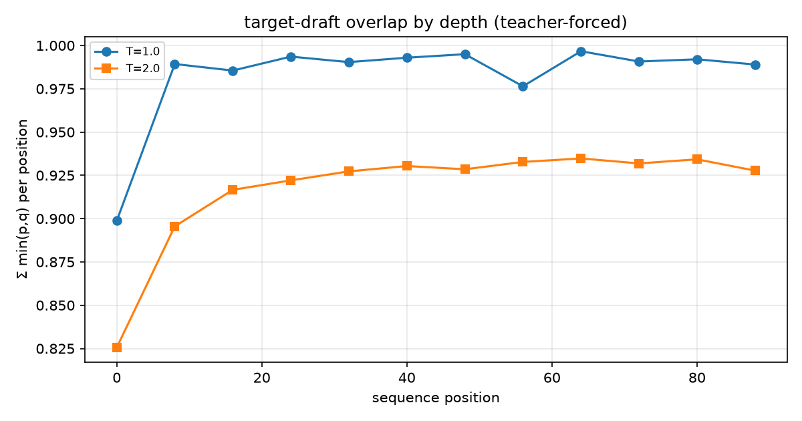

> **[LEGACY 2026-11-09]** 本报告使用旧统计口径，已被对应 v2 产物取代（见 README「v3 研究改造」）。保留仅作历史对照。

# 蒸馏对齐指标：Σmin(p,q) vs KL

验证集 teacher-forced，8 批 × 8 序列 × 95 位置。

| T | Σmin(p,q)（接受率上界） | KL(target||draft) | top-1 一致率 |
|---:|---:|---:|---:|
| 1.0 | 0.9861 | 0.0128 | 98.16% |
| 2.0 | 0.9196 | 0.0481 | 98.36% |

## 与实测接受率的对照

T=1.0 的 Σmin(p,q) 是任意提议分布下每 token 接受概率的上界；
实测逐 K 接受率（benchmark_fresh.json）均低于该上界，且 K 越大、
深处危险率衰减使实测越低于上界：

| K | 实测接受率 | 与上界的差距 |
|---:|---:|---:|
| 4 | 0.9750 | +0.0111 |
| 8 | 0.9316 | +0.0546 |
| 12 | 0.9290 | +0.0572 |
| 16 | 0.9043 | +0.0818 |
| 20 | 0.8633 | +0.1228 |
| 24 | 0.9014 | +0.0848 |
| 28 | 0.9063 | +0.0798 |
| 32 | 0.8674 | +0.1187 |

