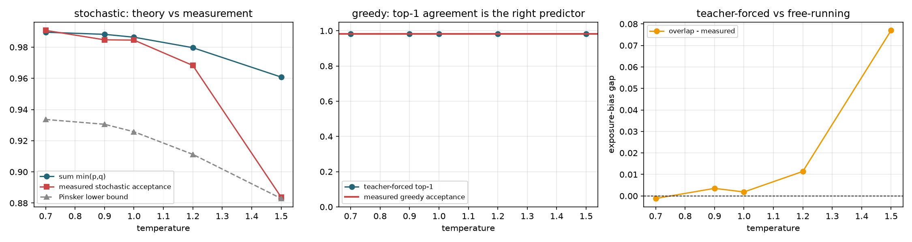

# 蒸馏对齐指标 v2：区分贪婪与随机模式

## v1 的错误

- `sum min(p,q) = 1 - TV(p,q)` 是**随机采样模式**的接受概率上界，
  与贪婪接受率不是同一个量。贪婪接受事件是 `argmax(q) == argmax(p)`。
- `Pinsker: TV <= sqrt(KL/2)` 给出 `E[accept] >= 1 - sqrt(KL/2)`，
  这才把 KL 蒸馏损失与接受率连成可推导的因果链。
- 「实测均低于上界」是恒真陈述，不构成验证。v1 标题承诺的
  「sum min 比 KL 更贴近接受率」没有任何相关系数或回归支撑。

协议：teacher-forced 对齐在验证集上测量；实测接受率由主库 trace 的风险集口径给出；
5 个温度形成独立条件用于相关性分析；每条件 3 次采样重复。

| T | sum min(p,q) | TV | KL | top-1 | Pinsker 下界 | 随机接受率 | overlap 差距 | 贪婪接受率 |
|---:|---:|---:|---:|---:|---:|---:|---:|---:|
| 0.7 | 0.9896 | 0.0104 | 0.0088 | 0.9823 | 0.9336 | 0.9907 | -0.0012 | 0.9813 |
| 0.9 | 0.9882 | 0.0118 | 0.0096 | 0.9823 | 0.9305 | 0.9847 | +0.0035 | 0.9813 |
| 1.0 | 0.9864 | 0.0136 | 0.0110 | 0.9823 | 0.9257 | 0.9845 | +0.0018 | 0.9813 |
| 1.2 | 0.9796 | 0.0204 | 0.0158 | 0.9823 | 0.9112 | 0.9682 | +0.0114 | 0.9813 |
| 1.5 | 0.9608 | 0.0392 | 0.0274 | 0.9823 | 0.8830 | 0.8838 | +0.0770 | 0.9813 |

## 相关性（跨温度）

- corr(sum min(p,q), 随机接受率) = +0.989
- corr(KL, 随机接受率) = -0.985（预期为负）
- corr(top-1, 贪婪接受率) = +nan（贪婪接受率跨温度为常数，相关系数不适用，故直接对比水平线）

## 结论

1. Pinsker 下界在全部 5 个温度上成立。
2. `sum min(p,q)` 是 teacher-forced 分布上的量，自由生成时存在 exposure bias，
   `overlap 差距` 列给出量化结果，不能把两者当成同一指标。
3. 贪婪模式应使用 top-1 一致率解释，与 TV/KL 无直接对应。
4. 贪婪输出与 target-only 逐 token 等价: True。

