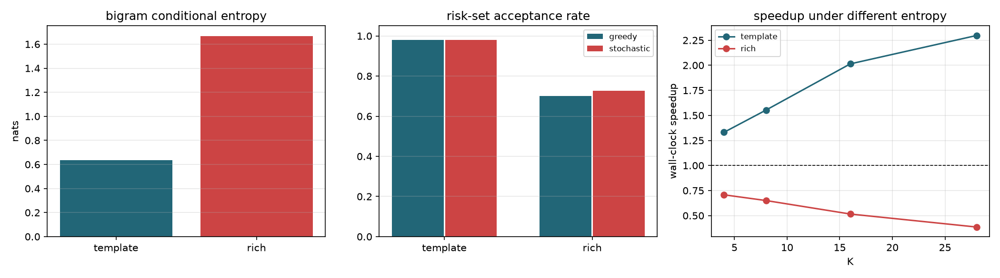

# 语料熵压力测试

原语料是 8 类固定句式，二元条件熵仅 0.637 nats，target 验证 CE 0.110，
下一 token 近乎确定。高熵语料是稀疏马尔可夫链，用于检验算法结论的边界。

| 语料 | 词表 | H1 | H2 | 可预测性 | target CE | sum min(p,q) | KL | Pinsker 下界 | 贪婪接受率 | 随机接受率 | 贪婪等价 |
|---|---:|---:|---:|---:|---:|---:|---:|---:|---:|---:|---|
| template | 247 | 5.070 | 0.637 | 0.874 | 0.110 | 0.9845 | 0.0135 | 0.9179 | 0.9804 | 0.9806 | True |
| rich | 260 | 5.423 | 1.668 | 0.692 | 3.738 | 0.7369 | 0.2127 | 0.6739 | 0.7012 | 0.7279 | True |

## 各 K 的墙钟加速

| 语料 | K=4 | K=8 | K=16 | K=28 |
|---|---:|---:|---:|---:|
| template | 1.331x | 1.553x | 2.014x | 2.297x |
| rich | 0.707x | 0.650x | 0.516x | 0.386x |

## 结论

高熵语料把 H2 从 0.637 提升到 1.668 nats，
贪婪接受率从 0.9804 变为 0.7012，最优加速从 2.297x 变为 0.707x。
这说明原项目报告的高接受率与加速比高度依赖低熵语料，
简历与报告必须保留该边界，不得外推到真实模型。

