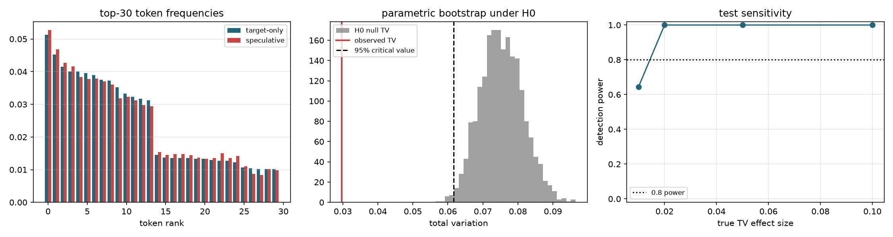

# 随机模式输出分布等价性与性能

## v1 的缺口

v1 只验证 `min(p,q) + (1-sum min(p,q))*normalize(max(p-q,0)) == p`
在随机生成的概率向量上成立，误差 < 1e-7。这是**一步代数恒等式**，
不能说明解码器整体采样自目标分布。且 v1 完全没有随机模式的性能数据。

## 检验设计

固定 prompt，target-only 与 speculative 各独立采 400 条长度 24 的序列。
H0: 两组来自同一个分类分布。以合并经验分布做参数自助，
得到 TV 的零分布与 p 值；按整条序列自助重采样给出 TV 的 95% CI；
再对给定效应量 delta 计算检出功效（power），使阴性结论可解释。
两组序列不以 seed 配对，比较的是分布而非逐条文本。

| 配置 | TV(unigram) | 95% CI | 零分布临界值 | p | 拒绝 H0 | TV(bigram) | 贪婪严格等价 | 随机模式 speedup |
|---|---:|---|---:|---:|---|---:|---:|---:|
| T=1.0 | 0.0297 | [0.0385, 0.0715] | 0.0617 | 1.000 | False | 0.0524 | True | 1.446x |
| T=0.8, top_k=10 | 0.0200 | [0.0233, 0.0569] | 0.0534 | 1.000 | False | 0.0262 | True | 1.504x |

## 检出功效

| 真实 TV 效应 | power |
|---:|---:|
| 0.01 | 0.645 |
| 0.02 | 1.000 |
| 0.05 | 1.000 |
| 0.10 | 1.000 |

## 结论边界

未拒绝 H0 只能结合 power 解读：在小效应量下检验可能没有分辨力，
不能表述为「已证明分布完全相同」。随机模式 speedup 为单 prompt 的
配对测量结果，样本量小，仅用于填补 v1 的性能空白，不作为简历主指标。

