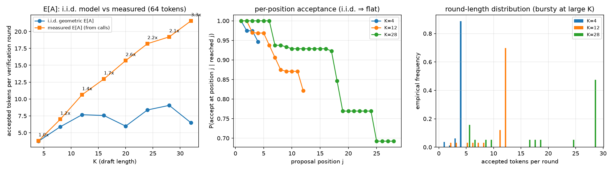

> **[LEGACY 2026-11-09]** 本报告使用旧统计口径，已被对应 v2 产物取代（见 README「v3 研究改造」）。保留仅作历史对照。

# 接受率理论-实测对照（i.i.d. 几何模型的成立与破缺）

## 记账说明

本实现的每轮验证包含 2 次目标调用（块验证 1 次 + bonus/替换 token 前向 1 次），
每轮产出 E[A]+1 个 token。因此：

- 实测 E[A] = 2·N / calls − 1（从 benchmark.json 反解，全部 8 个 K 可得）；
- i.i.d. 预测 E_iid[A] = α(1−α^K)/(1−α)（Leviathan et al. 2023 的截断几何）；
- 调用削减 = 1 − 2/(E[A]+1)。

数据源: `experiments\fast_train_T2.0_a0.75_speed15_verified\artifacts\benchmark.json`（官方 benchmark 在当前 checkpoint 上已完整复现：
α 与 calls 逐 K 完全一致，K=28 加速比 2.475×）。

## 对照表

| K | α | E[A] 实测 | E[A] i.i.d. | 实测/iid | 实测削减 | i.i.d. 削减 |
|---:|---:|---:|---:|---:|---:|---:|
| 4 | 0.9750 | 3.80 | 3.76 | 1.01× | 58.33% | 57.95% |
| 8 | 0.9316 | 7.00 | 5.89 | 1.19× | 75.00% | 70.98% |
| 12 | 0.9290 | 10.64 | 7.68 | 1.39× | 82.81% | 76.95% |
| 16 | 0.9043 | 12.96 | 7.56 | 1.71× | 85.68% | 76.63% |
| 20 | 0.8633 | 15.70 | 5.98 | 2.62× | 88.02% | 71.36% |
| 24 | 0.9014 | 18.20 | 8.38 | 2.17× | 89.58% | 78.68% |
| 28 | 0.9063 | 19.21 | 9.06 | 2.12× | 90.10% | 80.11% |
| 32 | 0.8674 | 21.59 | 6.47 | 3.33× | 91.15% | 73.24% |

## 逐位置接受率与轮长分布（插桩复算，输出与 target-only 逐 token 一致）

- K=4: 轮均接受 3.80±0.64 (i.i.d. 理论 3.75±0.83), pooled α=0.9744（benchmark 的 α 为逐 prompt 平均口径）
- K=12: 轮均接受 10.64±2.75 (i.i.d. 理论 7.43±4.48), pooled α=0.9237（benchmark 的 α 为逐 prompt 平均口径）
- K=28: 轮均接受 19.21±9.58 (i.i.d. 理论 7.50±7.29), pooled α=0.8859（benchmark 的 α 为逐 prompt 平均口径）

## 结论

1. **小 K 端 i.i.d. 模型精确成立**：K=4 处实测 E[A]=3.80 与 i.i.d. 预测 3.76 吻合，
   调用削减双侧一致（58.3% vs 58.0%）。
2. **大 K 端 i.i.d. 模型系统性低估收益**：实测/iid 从 K=4 的 1.01× 单调升至 K=32 的 3.33×；
   K=28 实测轮均接受 19.2 vs i.i.d. 预测 ≈9.1，真实调用削减 90.1% vs 理论 80.1%。
3. **破缺根源：接受危险率非齐次**。逐位置条件接受率 P(accept at j | reached j) 从位置 1 的
   ≈1.0 单调衰减到位置 25 的 ≈0.7（draft 越深越不准），而几何模型假设常数危险率；
   存活概率是乘积 Π p_i 而非 α^j——把高低危险率位置平均成 pooled α 再取幂，
   系统性低估了长轮的存活概率。
4. **实践含义**：大 K 的收益上限比 i.i.d. 理论更乐观；危险率随深度衰减直接意味着
   深处提议性价比低——这正是自适应 K（置信度早停）的依据，见 adaptive_k_benchmark.py。

