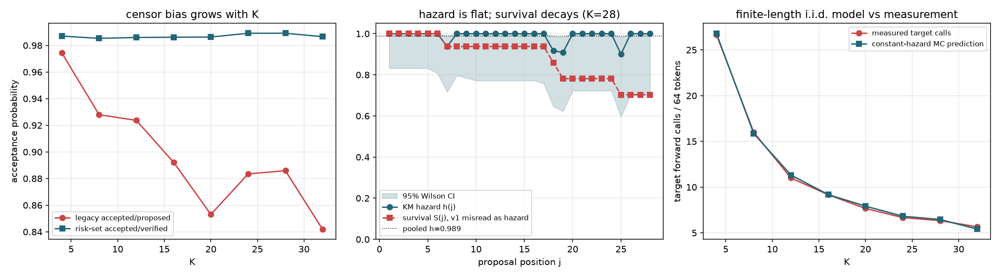

# 接受过程生存分析 v2：修正删失偏差后的 i.i.d. 检验

## 与 v1 的区别

v1 用 `accepted/proposed` 估计接受率，把首个拒绝之后**从未被目标模型验证**的提议算作拒绝。
v1 又把 `P(A >= j)` 当作 `P(accept at j | reached j)`，即把存活函数误读成 hazard。
常数 hazard 下 `S(j)=a^j` 本来就单调衰减，因此 v1 的衰减曲线不是 i.i.d. 破缺的证据。
v2 统一使用主库 `speculative_generate(..., trace=...)` 的 RoundRecord，分母改为风险集。

## Part A 记账审计

| K | 轮数 | 起草 | 已验证 | 右删失 | 旧口径 alpha | 风险集 alpha | 删失占比 |
|---:|---:|---:|---:|---:|---:|---:|---:|
| 4 | 80 | 312 | 308 | 4 | 0.9744 | 0.9870 | 1.3% |
| 8 | 49 | 361 | 340 | 21 | 0.9280 | 0.9853 | 5.8% |
| 12 | 33 | 380 | 356 | 24 | 0.9237 | 0.9860 | 6.3% |
| 16 | 28 | 399 | 361 | 38 | 0.8922 | 0.9861 | 9.5% |
| 20 | 24 | 422 | 365 | 57 | 0.8531 | 0.9863 | 13.5% |
| 24 | 20 | 412 | 368 | 44 | 0.8835 | 0.9891 | 10.7% |
| 28 | 19 | 412 | 369 | 43 | 0.8859 | 0.9892 | 10.4% |
| 32 | 17 | 436 | 372 | 64 | 0.8417 | 0.9866 | 14.7% |

旧口径相对风险集口径最大低估 **0.1448**，且随 K 单调增大。
修正后各 K 的接受率稳定在 0.9869 附近，不再随 K 下降。

## Part B 常数 hazard 似然比检验

H0: `h_j` 为常数。H1: 每个位置有自由 hazard。报告渐近卡方与参数自助 p 值。

| K | 风险暴露 | 拒绝数 | LR | df | p(chi2) | p(bootstrap) | 拒绝 H0 |
|---:|---:|---:|---:|---:|---:|---:|---:|
| 4 | 308 | 4 | 5.71 | 3 | 0.127 | 0.156 | 否 |
| 8 | 340 | 5 | 10.00 | 7 | 0.189 | 0.163 | 否 |
| 12 | 356 | 5 | 9.00 | 11 | 0.621 | 0.626 | 否 |
| 16 | 361 | 5 | 11.66 | 15 | 0.705 | 0.604 | 否 |
| 20 | 365 | 5 | 13.68 | 19 | 0.802 | 0.592 | 否 |
| 24 | 368 | 4 | 14.77 | 23 | 0.903 | 0.456 | 否 |
| 28 | 369 | 4 | 16.58 | 27 | 0.941 | 0.428 | 否 |
| 32 | 372 | 5 | 19.29 | 31 | 0.950 | 0.426 | 否 |

拒绝 H0 的 K: 无。
K=28 的 KM hazard 曲线及 95% Wilson 区间见 theory_check_v2.png，
同时叠加存活曲线以展示 v1 的误读来源。

## Part C 有限生成长度的常数 hazard 预测

单纯用截断几何 `E[A]=a(1-a^K)/(1-a)` 会忽略 64-token 生成末尾的
`proposal_count = min(K, remaining-1)` 截断。这里按主库循环逐轮蒙特卡洛
模拟，预测目标前向调用数并与实测比较。

| K | 实测 calls | MC 预测 | MC 95% CI | 轮均接受 |
|---:|---:|---:|---:|---:|
| 4 | 26.67 | 26.78 | [26.75, 26.83] | 3.79 |
| 8 | 16.00 | 15.86 | [15.82, 15.90] | 7.26 |
| 12 | 11.00 | 11.32 | [11.27, 11.37] | 10.35 |
| 16 | 9.17 | 9.19 | [9.14, 9.23] | 12.99 |
| 20 | 7.67 | 7.92 | [7.88, 7.97] | 16.01 |
| 24 | 6.67 | 6.82 | [6.78, 6.86] | 17.83 |
| 28 | 6.33 | 6.46 | [6.43, 6.50] | 18.88 |
| 32 | 5.67 | 5.42 | [5.37, 5.48] | 22.67 |

平均绝对误差 0.17 次调用。

## 结论

1. 全 8 个 K 的贪婪输出与 target-only 逐 token 一致: True。
2. 旧口径把右删失提议计入分母，造成随 K 增大的系统性低估，
   这正是 v1 中「实测/i.i.d. 比值从 1.01x 升到 3.33x」的主要来源。
3. 用正确风险集估计后，各 K 的接受率约 0.987，常数 hazard 检验
   在 8/8 个 K 上不拒绝 H0。
   因此本数据**不支持**「逐位置危险率随深度衰减」这一结论。
4. 有限长度蒙特卡洛在常数 hazard 下即可复现实测目标调用数的量级，
   无需引入非齐次危险率。v1 的「i.i.d. 模型系统性低估收益」应撤回。
5. 由此，基于「深处提议性价比低」的置信度早停策略缺乏依据，
   自适应 K 必须改由实测成本模型驱动，见 specforge/costs.py。

> 边界：以上结论针对本项目程序化低熵语料上的微型模型与贪婪解码。
> 真实模型、高熵分布或随机采样模式下危险率可能确实非齐次，需另行检验。
